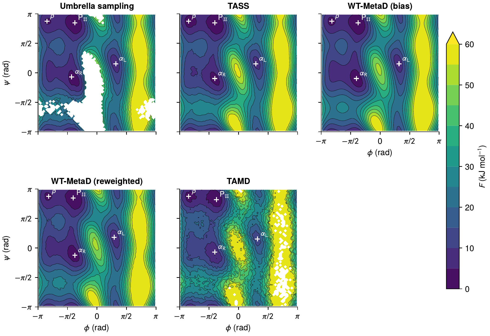
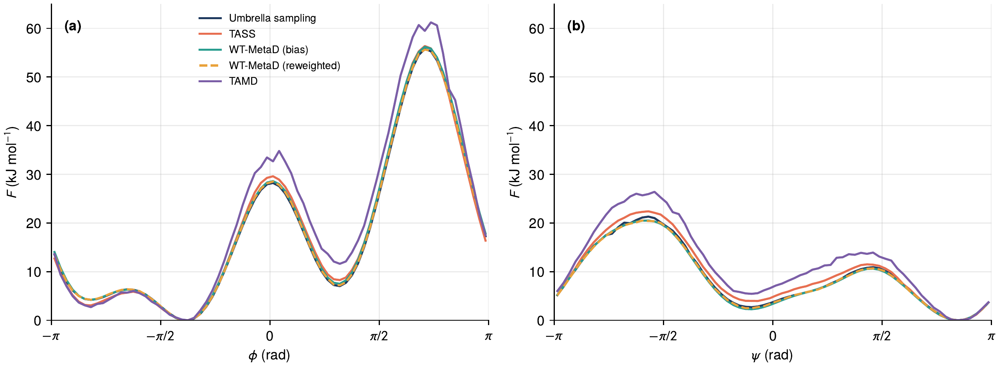
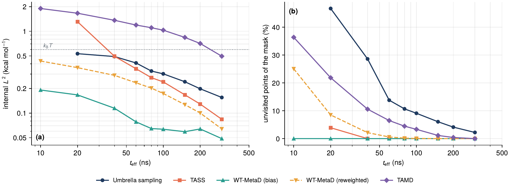
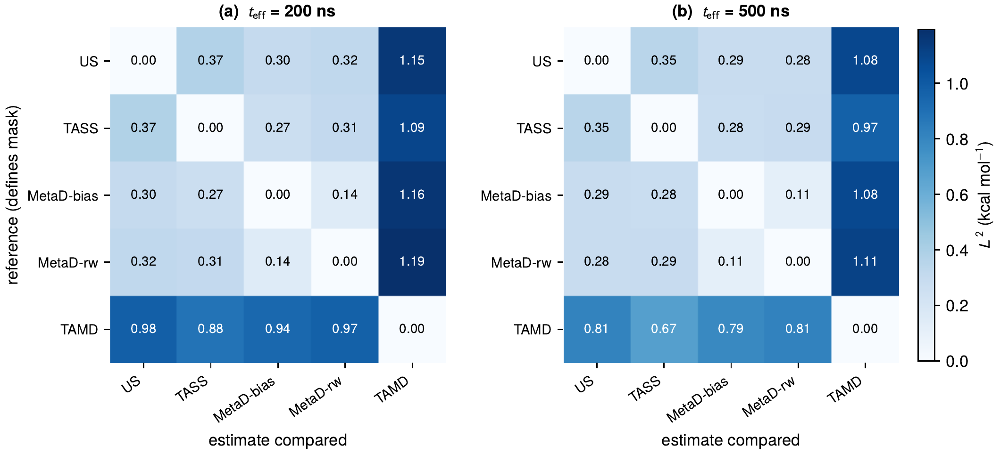

# Enhanced Sampling of Alanine Dipeptide in Water: A Performance Comparison

**CHM 391 Undergraduate Project, Department of Chemistry, IIT Kanpur**
Kruti Marthak · Neeru Nagra  |  Supervisor: Prof. Nisanth N. Nair

This repository contains the simulation code, PLUMED inputs and analysis scripts used to compute the conformational free-energy surface (FES) $F(\phi,\psi)$ of alanine dipeptide in explicit water with five enhanced-sampling methods, and to compare how accurately each method reproduces the surface as a function of the total simulation time. It accompanies the UGP report *Performance Comparison of Enhanced Sampling Methods for the Conformational Free-Energy Surface of Alanine Dipeptide*.

## Status

| Method | Production | Analysis |
|---|---|---|
| Umbrella sampling (US) | complete, 32 × 15.625 ns | complete |
| Well-tempered metadynamics (WT-MetaD) | complete, 1 × 500 ns | complete (two estimators) |
| TAMD / d-AFED | complete, 1 × 500 ns | complete |
| TASS | complete, 32 × 15.625 ns | complete |
| OPES in three windows | submitted, 3 windows (166.666 + 166.666 + 166.668 ns) | pending |

The results in `results/` are therefore an interim comparison of four methods. The final five-method comparison will be added when the OPES runs are complete.

## Methods

| Method | Bias / mechanism | FES estimator | Inputs |
|---|---|---|---|
| Umbrella sampling | 32 harmonic windows along $\phi$ | 2D WHAM | `common/plumed/us.template` |
| WT-MetaD | Gaussian bias on $(\phi,\psi)$ | sum of hills; reweighting with $V - c(t)$ | `common/plumed/metad.dat` |
| TAMD / d-AFED | auxiliary variables for $\phi,\psi$ at $T_s$ | histogram of the auxiliary variables at $T_s$ | `common/plumed/tamd.dat` |
| TASS | umbrella on auxiliary $\phi$ + WT-MetaD on auxiliary $\psi$, at $T_s$ | reweighting + WHAM at $T_s$ | `common/plumed/tass.template` |
| OPES (three windows) | `OPES_METAD` on $(\phi,\psi)$ inside three overlapping $\phi$ windows with walls | reweighting + WHAM (planned) | provided by our supervisor (not included) |

### Parameters

| Method | Parameters (energies kJ/mol, angles rad) |
|---|---|
| US | 32 centres 0.2 apart (`common/windows.sh`), $k = 500$ kJ mol⁻¹ rad⁻²; 100 ps chained preparation per window; 15.625 ns production per window; COLVAR every 0.1 ps |
| WT-MetaD | height 1.2, width 0.35, one Gaussian per ps, bias factor $\gamma = 10$, 150 × 150 bias grid, `CALC_RCT`; COLVAR every 1 ps |
| TAMD | `EXTENDED_LAGRANGIAN`, $\kappa = 5260$ kJ mol⁻¹ rad⁻², $\tau = 0.062$ ps, friction 100 ps⁻¹, $T_s = 1500$ K; COLVAR every 1 ps |
| TASS | auxiliary variables as in TAMD at $T_s = 900$ K; 32 umbrella windows on $\tilde\phi$ (same centres, $k = 500$); WT-MetaD on $\tilde\psi$ (height 2.4, width 0.05, one Gaussian per ps, $\gamma = 4$, at 900 K); same chained preparation as US; COLVAR every 0.1 ps |
| OPES | three overlapping windows along $\phi$; 166.666 + 166.666 + 166.668 ns |

The OPES input files were provided by our supervisor, Prof. Nisanth N. Nair, and are not included in this repository. The OPES windows are run in the same OpenMM + PLUMED set-up as the other methods; `common/build_opes.sh` builds PLUMED's `OPES_METAD` as a runtime library, because the PLUMED 2.9.2 build used has no OPES module.

## Simulation set-up

| | |
|---|---|
| System | Ace–Ala–Nme, AMBER ff14SB, TIP3P water, 2,767 atoms, periodic |
| Equilibration | minimisation, heating to 300 K, 2 ns $NPT$ at 300 K and 1 bar; the final state (positions, velocities, box) is the common starting state |
| Engine | OpenMM 8.4 + openmm-plumed 2.1 + PLUMED 2.9.2 |
| Hardware | NVIDIA Tesla V100, OpenCL platform, mixed precision (PARAM Sanganak, SLURM) |
| Production ensemble | $NVT$ at the final $NPT$ box, 300 K, `LangevinMiddleIntegrator`, friction 1 ps⁻¹ |
| Time step | 2 fs; bonds to hydrogen constrained, rigid water |
| Electrostatics | PME, 1.0 nm real-space cut-off |
| CVs | $\phi$ (atoms 5-7-9-15), $\psi$ (atoms 7-9-15-17) |
| Checkpoints | every 100 ps (OpenMM state and PLUMED files synchronised); runs continue from checkpoints after the wall-time limit |
| Units | kJ/mol, nm, ps, rad (PLUMED); L² errors reported in kcal/mol |

WT-MetaD and TAMD start directly from the equilibrated state. Umbrella sampling and TASS start from 32 window structures generated by a chained 100 ps preparation run per window, started from the equilibrated state. The preparation runs are not counted in $t_{\text{eff}}$.

The auxiliary variables of `EXTENDED_LAGRANGIAN` have no restart file in PLUMED 2.9.2; at every continuation they are re-initialised at the current $\phi,\psi$ with zero velocity.

## Repository layout

```
.
├── README.md
├── environment.yml       conda environment (OpenMM, openmm-plumed, PLUMED, numpy, scipy, matplotlib)
├── config.sh             every setting: paths, SLURM, MD settings, lengths, analysis
├── submit.sh             submits the jobs (check, preparation, windows, single trajectories)
├── system/               topology and equilibrated starting state
├── common/
│   ├── md.py             OpenMM + PLUMED runner with checkpoint/restart
│   ├── lib.sh            shared shell functions
│   ├── windows.sh        window centres and force constant (US, TASS)
│   ├── status.py         progress of every run
│   ├── build_opes.sh     builds PLUMED's OPES_METAD as a runtime library
│   └── plumed/           PLUMED inputs: us.template, metad.dat, tamd.dat, tass.template
├── slurm/                job scripts: environment/smoke/restart check, preparation, windows, single runs
├── checks/               check_env.py, check_outputs.py
├── analysis/             FES estimators, L² error, convergence table, plots
├── ref/                  how to supply the GASS reference surface (not included)
└── results/              FES files and L² tables of the four completed methods
```

### Analysis scripts (`analysis/`)

| Script | Purpose |
|---|---|
| `fesutils.py` | COLVAR reading, periodic grids, histograms, FES I/O, periodic interpolation |
| `wham2d.py` | 2D WHAM for windows biased along $\phi$ (US at 300 K; TASS at 900 K with `metad.rbias` weights) |
| `reweight_fes.py` | FES by reweighting (WT-MetaD with `metad.rbias`; TAMD at $T_s$) |
| `sumhills_py.py` | bias-derived WT-MetaD FES from `HILLS` (pure-Python `sum_hills`) |
| `metad_checkpoints.py` | the same with `plumed sum_hills`, where PLUMED is installed |
| `run_fes_checkpoints.sh` | all FES at all $t_{\text{eff}}$ checkpoints |
| `l2_error.py` | $L^2$ error function and command-line tool |
| `plot_compare.py` | 2D/1D FES figures, internal and pairwise $L^2$, $L^2$ against a reference |
| `plot_external.py` | comparison with the GASS reference (maps, difference maps, profiles, table) |
| `plot_individual.py` | per-method $L^2$ curves |
| `convergence_table.py` | first $t_{\text{eff}}$ below $k_BT$ / 0.5 kcal/mol (report Tables 6.3–6.4) |
| `plot_fes.py`, `plot_overlap.py`, `plot_traces.py` | single FES maps, window overlap, CV time series |

## Requirements

```bash
conda env create -f environment.yml
conda activate ugp_gpu
bash common/build_opes.sh        # once; only needed for OPES
```

A SLURM cluster with a GPU partition is assumed for production (`config.sh`, block `SITE`). The analysis needs only Python with numpy, scipy and matplotlib.

## Running the simulations

```bash
export PROJ=/path/to/project            # output root; system files in $PROJ/01_system
cp system/ala_water.prmtop system/gpu_npt_final.xml $PROJ/01_system/
nano config.sh                          # SITE block: environment activation, partition, wall time, account

bash submit.sh check                    # environment check + smoke/restart test of every method (GPU node)
bash submit.sh us_prep                  # 32 x 100 ps chained preparation
bash submit.sh tass_prep
bash submit.sh metad                    # 500 ns, resubmits itself until finished
bash submit.sh tamd
bash submit.sh us_prod                  # 32 production windows (job array), after us_prep
bash submit.sh tass_prod                # after tass_prep
bash submit.sh status                   # progress of every run
```

## Analysis

```bash
# 1. FES at every t_eff checkpoint (10, 20, 40, 60, 80, 100, 150, 200, 300, 500 ns)
DATA=/path/to/production_output bash analysis/run_fes_checkpoints.sh

# 2. L2 errors and figures (inside results/)
cd results
PYTHONPATH=../analysis python3 ../analysis/plot_compare.py                  # internal + pairwise
PYTHONPATH=../analysis python3 ../analysis/plot_compare.py --ref fes_ref.dat
PYTHONPATH=../analysis python3 ../analysis/plot_external.py                 # needs fes_ref.dat
python3 ../analysis/convergence_table.py l2_ref.csv
```

**Effective simulation time.** $t_{\text{eff}}$ is the total production time of a method: the trajectory length for WT-MetaD and TAMD, and $32 \times t_w$ for the window methods, where every window contributes its first $t_{\text{eff}}/32$. The first 0.5 ns of each US/TASS window and the first 1 ns of the WT-MetaD trajectory (reweighted estimate) are discarded but still counted in $t_{\text{eff}}$.

**$L^2$ error.** All surfaces are put on a common 72 × 72 grid (5° bins) and shifted to a minimum of zero. Over the grid points with $F_{\text{ref}} < F_{\text{cut}} = 14.58$ kcal/mol (61.0 kJ/mol) that the estimate has visited,

$$
L^2 = \sqrt{\frac{1}{N_g}\sum_{i=1}^{N_g}\bigl[F_{\text{sim}}(i)-\Delta-F_{\text{ref}}(i)\bigr]^2},\qquad
\Delta = \frac{1}{N_g}\sum_{i=1}^{N_g}\bigl[F_{\text{sim}}(i)-F_{\text{ref}}(i)\bigr],
$$

i.e. $F_{\text{sim}}$ is mean-aligned to $F_{\text{ref}}$. Unvisited points are excluded and reported separately. $L^2$ is reported in kcal/mol; surfaces are plotted in kJ/mol. Three references are used: each method's own 500 ns surface (internal convergence), the other methods at the same $t_{\text{eff}}$ (pairwise agreement), and the GASS surface (external agreement).

**Bias-derived WT-MetaD estimate.** PLUMED writes well-tempered hill heights in `HILLS` already multiplied by $\gamma/(\gamma-1)$, so the sum of the stored Gaussians equals $-F$. `sumhills_py.py` therefore computes $F = -\sum(\text{stored hills})$ and applies no further factor; `plumed sum_hills` (`metad_checkpoints.py`) gives the same result.

**Reference.** The GASS surface was provided for this project and is not included (`ref/README.md`). Its simulation conditions are not recorded with the file, so it serves as an external benchmark rather than an exact reference.

## Results at $t_{\text{eff}} = 500$ ns (interim, four methods)

External $L^2$ error against the GASS reference (kcal/mol, mean alignment; 4619 reference points), from `results/l2_external_table.csv`:

| Estimate | $L^2$ | unvisited points |
|---|---|---|
| Umbrella sampling | 0.48 | 596 |
| TASS | 0.45 | 0 |
| WT-MetaD (sum of hills) | 0.38 | 0 |
| WT-MetaD (reweighted) | 0.41 | 0 |
| TAMD | 1.12 | 44 |

These are single runs with one set of parameters per method, without statistical uncertainties; differences of about 0.1 kcal/mol between methods are not resolved by this comparison. The bias-derived WT-MetaD estimate has no unvisited points by construction (a sum of Gaussians is finite everywhere). See the report, Chapter 6, for the full analysis.

## Key references

1. G. M. Torrie and J. P. Valleau, *J. Comput. Phys.* **23**, 187 (1977). Umbrella sampling
2. S. Kumar *et al.*, *J. Comput. Chem.* **13**, 1011 (1992). WHAM
3. A. Barducci, G. Bussi and M. Parrinello, *Phys. Rev. Lett.* **100**, 020603 (2008). Well-tempered metadynamics
4. M. Invernizzi and M. Parrinello, *J. Phys. Chem. Lett.* **11**, 2731 (2020). OPES
5. L. Maragliano and E. Vanden-Eijnden, *Chem. Phys. Lett.* **426**, 168 (2006). TAMD
6. J. B. Abrams and M. E. Tuckerman, *J. Phys. Chem. B* **112**, 15742 (2008). d-AFED
7. S. Awasthi and N. N. Nair, *J. Chem. Phys.* **146**, 094108 (2017). TASS
8. A. Pal *et al.*, *J. Comput. Chem.* **42**, 1996 (2021). Mean-force TASS; $L^2$ error
9. R. Javed, A. B. Kapakayala and N. N. Nair, *J. Chem. Theory Comput.* **20** (2024), [doi:10.1021/acs.jctc.4c00776](https://pubs.acs.org/doi/10.1021/acs.jctc.4c00776). Bucket sampling
10. P. Eastman *et al.*, *J. Phys. Chem. B* **128**, 109 (2024). OpenMM 8
11. G. A. Tribello *et al.*, *Comput. Phys. Commun.* **185**, 604 (2014). PLUMED 2

## Acknowledgements

We thank Prof. Nisanth N. Nair for his guidance throughout this project and for providing the OPES input files.


## Results (interim, four of five methods)

Free-energy surfaces of alanine dipeptide in water at $t_{\text{eff}} = 500$ ns:



One-dimensional profiles along $\phi$ and $\psi$:



Internal convergence and sampling coverage as a function of $t_{\text{eff}}$:



Pairwise agreement between methods:



At 500 ns, umbrella sampling, TASS and WT-MetaD agree with one another to 0.28–0.35 kcal/mol in $L^2$, while TAMD deviates systematically. OPES results will be added when the runs are complete. Captions for all figures: [`results/figures/README.md`](results/figures/README.md).
